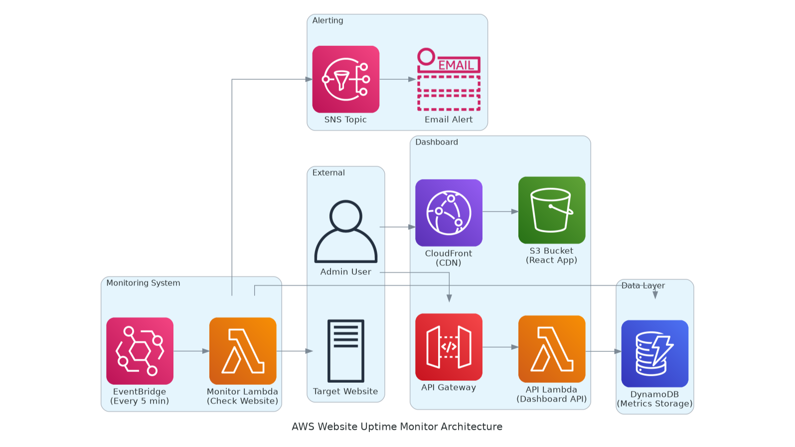

# Website Uptime Monitor

> **Real-time website monitoring with automated alerts and beautiful dashboard**

[](https://terraform.io)
[](https://aws.amazon.com)
[](https://reactjs.org)
[](https://nodejs.org)

A complete serverless solution for monitoring website uptime with real-time dashboard, automated alerts, and comprehensive metrics tracking. Built with AWS Lambda, DynamoDB, and React — **fully automated and scalable**.

## Features

- 🔍 **Automated Website Monitoring** with customizable ping schedules
- 📊 **Real-time Dashboard** showing uptime metrics and response times
- 📧 **Email Alerts** for downtime and performance issues
- 📈 **Historical Data** with monthly aggregated metrics
- ⚡ **Serverless Architecture** with auto-scaling capabilities
- 🎨 **Beautiful UI** with responsive design and smooth animations
- 🔒 **Secure & Cost-effective** with pay-per-use pricing

## Architecture



The monitoring system follows a modern serverless architecture:

| Component | Purpose |
|-----------|---------|
| **EventBridge** | Triggers uptime checks on scheduled intervals |
| **Lambda Functions** | Execute monitoring logic and serve API endpoints |
| **DynamoDB** | Stores uptime metrics and historical data |
| **CloudFront + S3** | Hosts the React dashboard with global CDN |
| **SNS** | Sends email notifications for alerts |

## 🚀 Quick Start

### Prerequisites

- AWS CLI configured with appropriate permissions
- Terraform >= 1.0
- Node.js >= 22
- npm or yarn package manager

### 1️⃣ Clone & Setup

```bash
git clone https://github.com/HasanAshab/aws-website-uptime-monitor
cd website-uptime-monitor
```

### 2️⃣ Configure Variables

Create `infra/envs/prod.tfvars`:

```hcl
environment                   = "prod"
aws_region                   = "us-west-2"
target_website_url           = "https://your-website.com"
uptime_alert_subscriber_email = "your-email@example.com"
uptime_ping_schedule         = "cron(*/5 * * * ? *)"  # Every 5 minutes

uptime_assertions = {
  status_code          = 200
  body_includes        = "Welcome"
  max_response_time_ms = 1000
}
```

### Deploy Infrastructure

```bash
cd infra
terraform init
terraform workspace new prod
terraform plan -var-file=envs/prod.tfvars
terraform apply -var-file=envs/prod.tfvars
```

**What gets created:**
- ✅ DynamoDB table for metrics storage
- ✅ Lambda functions for monitoring and API
- ✅ EventBridge rules for scheduled checks
- ✅ SNS topic for email alerts
- ✅ CloudFront distribution for dashboard
- ✅ S3 bucket for static website hosting

### Access Your Dashboard

After deployment, Terraform will output the dashboard URL:

```bash
terraform output dashboard_url
```

## Usage

### Dashboard Features

#### 📊 Monthly Metrics
- **Uptime Percentage**: Shows successful checks ratio for current month
- **Invalid Status Count**: Number of unexpected HTTP status codes
- **Average Response Time**: Mean response time across all checks

#### Real-time Monitoring
- **Response Time Chart**: Visual timeline of response times (last 30 minutes)
- **Recent Ping Results**: Detailed list of recent ping attempts with status
- **Auto-refresh**: Dashboard updates every minute automatically

### API Endpoints

The system exposes three main API endpoints:

```bash
# Get monthly aggregated metrics
GET /metrics

# Get recent ping results (last 30 minutes)
GET /recent-pings

# Get all uptime data
GET /uptime-data
```

### Monitoring Configuration

Customize your monitoring setup in `terraform.tfvars`:

```hcl
# Ping frequency (EventBridge cron expression)
uptime_ping_schedule = "cron(*/5 * * * ? *)"  # Every 5 minutes

# Website assertions
uptime_assertions = {
  status_code          = 200                    # Expected HTTP status
  body_includes        = "Welcome"              # Text that should be present
  max_response_time_ms = 1000                   # Maximum acceptable response time
}
```

## 🛠️ Configuration

### Terraform Variables

| Variable | Type | Default | Description |
|----------|------|---------|-------------|
| `environment` | string | `dev` | Environment name (dev/staging/prod) |
| `aws_region` | string | `us-west-2` | AWS deployment region |
| `target_website_url` | string | `https://example.com/` | Website URL to monitor |
| `uptime_ping_schedule` | string | `cron(0 0 * * ? *)` | EventBridge cron expression |
| `uptime_alert_subscriber_email` | string | - | Email for downtime alerts |
| `db_billing_mode` | string | `PAY_PER_REQUEST` | DynamoDB billing mode |

### Environment-specific Configurations

Create separate `.tfvars` files for different environments:

```bash
infra/envs/
├── dev.tfvars
├── staging.tfvars
└── prod.tfvars
```

## Project Structure

```
├── dashboard/
│   ├── backend/           # Lambda functions (Node.js)
│   │   └── functions/     # API handlers
│   └── frontend/          # React dashboard
│       └── src/           # React components
├── infra/                 # Terraform infrastructure
│   ├── modules/           # Reusable Terraform modules
│   │   ├── dashboard/     # Dashboard infrastructure
│   │   └── uptime_monitor/ # Monitoring infrastructure
│   └── envs/              # Environment-specific configs
└── .github/workflows/     # CI/CD pipelines
```

## 🔧 Development

### Backend Development

```bash
cd dashboard/backend
npm install
npm run test
npm run lint
```

### Frontend Development

```bash
cd dashboard/frontend
npm install
npm start          # Development server
npm run build      # Production build
```

### Infrastructure Testing

```bash
cd infra
terraform plan -var-file=envs/dev.tfvars
terraform apply -var-file=envs/dev.tfvars
```

## CI/CD Pipeline

The project includes automated GitHub Actions workflows:

- **Backend CI/CD**: Tests, lints, and deploys Lambda functions
- **Frontend CI/CD**: Builds and deploys React dashboard
- **Infrastructure**: Validates and applies Terraform changes

### Required GitHub Secrets

```bash
AWS_ACCESS_KEY_ID          # AWS access key
AWS_SECRET_ACCESS_KEY      # AWS secret key
```

## Monitoring & Alerts

### Email Notifications

Configure email alerts for:
- Website downtime
- Response time threshold exceeded
- Invalid HTTP status codes
- Connection timeouts

### CloudWatch Integration

Monitor system health through:
- Lambda function logs
- DynamoDB metrics
- API Gateway performance
- CloudFront access logs

## Cleanup

Remove all resources:

```bash
cd infra
terraform destroy -var-file=envs/prod.tfvars
```


